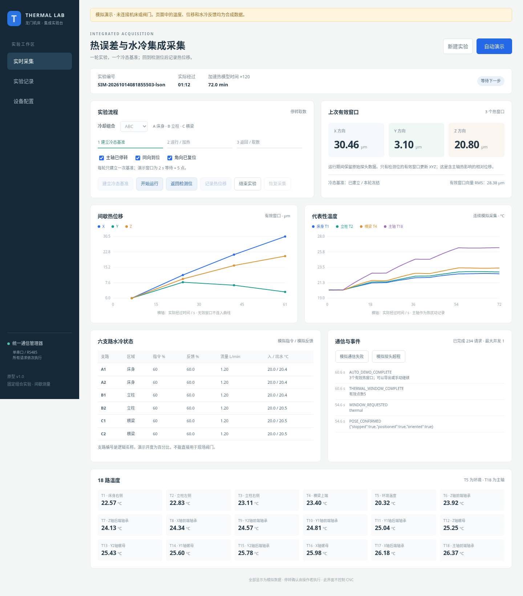

# 热误差与三区水冷集成采集原型 v1.0

这是可操作的**模拟原型**：18 路温度、三探头、三区六支路、一次冷态基准、运行与停转回测、异常标记和统一导出。通信层由一个管理器依次执行请求，适合后续接入同一条 RS485 总线。

**当前不打开串口，不写真实阀门，不控制 CNC。所有曲线和反馈均为合成数据，不能用来证明冷却效果。** MATLAB 与网页是独立实现；网页截图不代表 MATLAB GUI 已经实际运行。



## 先看效果：网页演示

1. 下载完整 ZIP 并解压。
2. 用 Edge / Chrome / Firefox 打开 `preview/index.html`，不需要联网。
3. 点击 **自动演示**，约 62 秒生成一次基准和三个热位移窗口。期间“到位”等确认均由演示程序虚拟生成。
4. 在 **实验记录** 下载原始数据、窗口、事件 CSV 和元数据 JSON。

受企业浏览器策略限制时，可在解压目录启动本地静态服务：

```bash
python -m http.server 8000 --directory preview
```

然后打开 `http://localhost:8000`。网页没有 CDN、在线字体或第三方前端依赖。本次浏览器验证通过本地静态服务进行。

## MATLAB 版本

面向 MATLAB R2021b，使用基础 MATLAB 的 figure / uicontrol / timer，不依赖 App Designer 或通信工具箱。切换到解压后的项目目录，再运行：

```matlab
addpath(fullfile(pwd,'matlab'));
IntegratedThermalLab
```

点击 **一键自动演示**，演示一次基准、一次运行和一次有效热窗口；或者按下面顺序手动操作。运行期间请保留界面，关闭时计时器会停止。

核心验证脚本：

```matlab
addpath(fullfile(pwd,'matlab'));
run_core_tests
```

本次环境没有 MATLAB / Octave：已审查源码并解析所有 `.m` 文件语法，**未实际运行 MATLAB GUI 或断言脚本**。如本机出现报错，请保留完整错误和行号以便修正。

## 手动实验流程

1. 新建实验，选择 `0 / A / B / C / AB / AC / BC / ABC`。A=床身，B=立柱，C=横梁，每区两支路。
2. 确认主轴停转、同向到检测位、角向复位，建立本轮唯一冷态基准。基准采完后不能覆盖；更换组别需新建一轮。
3. 开始运行。模型加热、温度连续记录，六支路按本轮固定组合执行模拟开度；运行中探头读数保留，不能作为有效 XYZ。
4. 返回检测位，重新完成三项确认，等待稳定后采窗口。
5. 有效窗口更新 XYZ；超程、通信失败、丢失定位确认或取消窗口保留原因，不能作为零位移。
6. 继续运行与回测，结束并导出。通信恢复保留原基准，但清除三项确认。

停转、同向到位和主轴角向复位是现场必须完成的操作；勾选框仅记录确认。不能通过强行让探头读数恢复初值来找主轴角度。

## 数据的含义

- `raw.csv` / 网页 `*_rawCsv.csv`：18 温度、3 原始探头、6 阀指令与模拟反馈、流量、水温、质量和实际时间。
- `windows.csv`：基准/热窗口、实际起止、有效性、原因、点数、XYZ 和窗口内标准差。
- `events.csv`：组别、基准、运行、确认、故障和结束记录。
- `metadata.json`：实验 ID、模式、基准、演示配置、标定来源和单位约定。

实际 UTC 与单调经过时间单独保存；`simulation_time_s` 是 120 倍加速模型时间，不能当成实际采集时间。网页模型仅累计运行阶段；MATLAB 模型持续推进热时钟，停转回测期间也模拟降温。两版演示热模型不同，不用于互相比对数值或验证真实机床响应。通信读取依次执行，各类读数不保证同一瞬间。

XYZ 约定为 `C × (基准三探头值 − 当前三探头值)`，单位 μm。C 为理想 45° 几何的演示矩阵；**实际符号、方位、仰角、通道灵敏度和工作间隙需现场标定**。输出是球心相对探头架的总位移，保留主轴、球杆和结构热影响。

网页的有效窗口向量 RMS 为 `sqrt(mean(X²+Y²+Z²))`，仅用于查看当前演示窗口，不代表运行期连续 RMS，也不是不同冷却组的正式效果比较。

演示参数为 1 s 轮询、2 s 稳定等待、5 点窗口、±100 μm 探头范围、启用支路 60% 开度。这些数值仅用于查看流程，不能直接作为现场参数。阀门指令与反馈、开度与流量都分别记录；模型流量不证明真实冷却输入。该版未实现流量闭环、Shapley 贡献计算或 XYZ 间歇反馈。

## 真实设备接入前

填写 [设备映射模板](config/device_map_template.csv) 和 [接入核对表](config/hardware_readiness.md)。旧程序温度/探头与水冷的从站地址可能冲突，波特率也不一致，不能直接合并后运行。

MATLAB 的 `+itl/SimTransport.m` 与网页模拟模型为明确的适配边界。当前队列仅对模拟同步任务串行执行；真实通信需要实现超时、重试、逐请求时间、读写校验和断通信处理，并保持唯一端口所有者。直接将模式改成 real 会报错，不能自动回退成模拟。

## 本次验证

- Node 模型回归：18 项通过，涵盖基准、位姿、稳定期间与采样期间的超程、非有限值、故障恢复、取消、串行队列、导出、位移符号和实际运行时长。
- Chromium 浏览器验证：自动/手动流程、下载 CSV、冻结组别、异常恢复、配置页和页面错误检查。
- MATLAB：源码独立审查、语法解析；运行与硬件待本机验证。

复跑网页测试需要 Node 和 Playwright（仅测试需要，使用界面无需安装）：

```bash
node --test preview/tests/lab-engine.test.js
node preview/tests/browser-smoke.js
```

浏览器测试当前使用 Linux 的 `/usr/bin/chromium`。其他系统可在测试文件中设置本机 Chromium 路径；这不影响网页使用。
