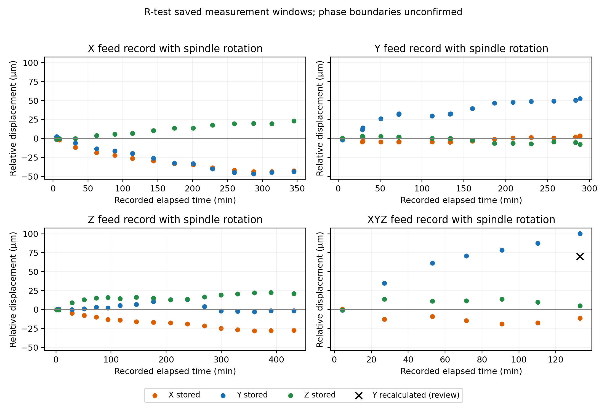

# 基于非接触 R-test 的龙门机床多工况三维热漂移实验研究

> 中文期刊论文初稿 v0.2。研究范围已按用户决定调整：使用已有三电涡流 R-test 原理测量数据撰写当前文章，API 五点装置及分区冷却预测控制保留为后续研究。现有数据为四次无分区水冷记录，不是八组合冷却试验。本稿含重新核算的描述性结果，尚不是可直接投稿的定稿。

## 摘要

针对龙门机床不同运动条件下三维热漂移及末段恢复响应的表征问题，采用基于非接触 R-test 原理的三电涡流测量系统，对主轴旋转条件下 X、Y、Z 单轴进给及 XYZ 联动四种工况开展固定测量位姿的间歇回测分析。运行时主轴持续旋转，回测时主轴停转；利用各文件保存的冷态基准和标定矩阵，将三路探头变化量换算为球心相对探头架的三维位移，并与温度及测量窗口记录关联。四份记录分别包含 14、16、17 和 7 个位移样本，共 54 个。逐窗口复核表明，探头均值及三向窗口标准差可由保存的窗口数据复现；XYZ 联动末点的原存 Y 值与矩阵复算相差 30 μm，原值保留并按复算口径另存分析。该口径下，四份记录中已观测窗口的三维位移幅值最大值分别为 66.77、53.43、35.67 和 89.88 μm。末段数据呈现三向变化不同步以及局部温度下降时位移仍继续变化的现象。由于各记录环境、时长和运动参数不同，以上结果用于描述所记录工况，不作为等热输入条件下的性能排序；停止进给时刻及冷却分界仍需补充确认。

**关键词：** 龙门机床；非接触 R-test；三维热漂移；间歇测量；运动工况；温度响应

## 1 引言

机床热状态变化会改变刀具侧与工件侧之间的相对位置。温度测量、目标点位移获取以及热误差建模共同构成热误差研究的重要环节[1]。对于龙门机床，主轴与进给部件的运行以及环境温度变化均可能参与热响应，因而需要在明确的运行条件和测量基准下记录三维相对位移。

采用标准球与多方向位移探头建立非接触测量链，可以通过几何关系或局部标定将探头读数换算为球心位移。非接触 R-test 的结构参数和标定方法会影响其测量能力，已有研究围绕这些问题开展优化[2]。本文借用其三方向球心测量原理用于定点热漂移回测，不将本装置等同于已经通过标准化性能验证的商业 R-test 仪器。

在实际试验中，标准球随进给运动离开探头有效区域，需要暂停运行、返回同一位姿并在静止窗口读取数据。温度可以连续记录，而有效位移仅在若干窗口获得。因此，连续保存的探头序列不能直接视为连续热漂移；返回重复性、标定、球杆及探头架温漂和测量时延都需要纳入解释。对于停机后的恢复，还应区分温度下降、目标点发生移动和目标点接近初始位置三种不同含义。

本文以已有 X、Y、Z 单轴进给和 XYZ 联动四份无分区水冷记录为对象。四组运行时均包含主轴旋转，测量时停转，故其响应不是纯进给热源的独立作用。研究首先明确三探头转换与冷态基准，复核有效窗口及计算一致性，随后从带符号 XYZ、三维综合幅值和温度变化分析各记录的热漂移特征。研究不以这些记录反推床身、立柱、横梁的独立产热贡献，也不报告尚未开展的水冷抑制或闭环控制效果。

【文献待补：不同进给与主轴联合热激励、间歇热位移测量、温度—位移滞后及恢复过程相关原始研究。当前不据有限引用宣称方法首次提出。】

## 2 非接触 R-test 原理及测量方法

### 2.1 测量对象与空间布置

三只电涡流探头固定在工作台侧夹具上，标准球位于主轴/刀具侧。历史方案记载三探头轴线与 XY 水平面夹角为 45°，水平投影相隔 120°，实际方向、探头编号和装夹尺寸须与本批试验照片及记录核对。测量输出为球心相对探头架的三维位移，以球心作为等效刀尖时，应报告球杆长度、机床偏置和球心位置；不能自动推广到其他刀具长度。

历史记录的测点候选为 (0, −337.3, −500) mm，其是否为本批四组实际测点尚待核实。机床型号、球径、探头型号/仪表性能、球杆材料与装夹、测点坐标及测量链温度布置列入表 1【待填写】，不将 API 量棒的 Lp/Ls 参数用于本测量链。

### 2.2 理想几何与实测标定

令探头轴线与水平面的夹角为 β，装置坐标中探头方位角为 0°、120°、240°。在三轴线通过球心、读数正负统一、球半径及几何参数在小位移比较中不变的理想条件下，有

$$
\mathbf d=H_g\Delta\mathbf r_R,\qquad
H_g=\begin{bmatrix}
\cos\beta&0&\sin\beta\\
-\cos\beta/2&\sqrt{3}\cos\beta/2&\sin\beta\\
-\cos\beta/2&-\sqrt{3}\cos\beta/2&\sin\beta
\end{bmatrix}. \tag{1}
$$

式（1）的 d 是经响应标定的有符号轴向等效变化，不是可以无条件代入的电压或原始仪表读数。实际计算优先采用本轮文件保存的三探头到机床坐标转换矩阵 C：

$$
\Delta\mathbf x_k=C(\overline{\mathbf p}_k-\mathbf p_0),\qquad
\Delta\mathbf x_k=[\Delta X_k,\Delta Y_k,\Delta Z_k]^\mathsf T. \tag{2}
$$

其中 p0 为该轮冷态基准，p̄k 为第 k 个有效窗口探头均值。本批工作簿的探头值及 XYZ 均注明为 μm。若另用灵敏度矩阵 H 定义 Δp＝HΔx，则 C＝H⁻¹，二者方向不能混淆。实际分析使用各文件内部保存的 C，不以理想几何矩阵替代，也不混用不同文件的零点。

X/Y/Z 单轴三份文件保存同一 C，XYZ 联动保存另一 C，差异原因及标定日期待追溯。矩阵换算的数值复现仅证明内部一致性，不等于完成标定准确度、坐标方向或可溯源性验证。

### 2.3 运行、返回与窗口采集

用户确认四组运行阶段主轴持续旋转，回测阶段停转。进给运动和主轴的实际速度、负载、回测前停转延迟及角向复位规则需结合实验日志补齐；此前 API 方案中的“主轴全程停转”不是本批历史实验条件。

各文件记录连续采样理论周期为 2 s，到位后稳定等待为 5 s，每个热误差窗口为 5 点，首末理论间隔 8 s，名义窗口时长 10 s；冷态基准使用 10 点。文件时间网格不能单独证明串口真实逐点计时准确，应保留该限制。

回测时球应处于有效间隙内，主轴和进给均停止，按同一最终接近方向到位，并完成稳定等待和窗口采样。需补充本批实际执行的路线、同向复位及角向重复性记录，不能将建议操作写成已证实的历史事实。每轮沿用同一冷态基准；标定文件零位与该轮冷态零点分别记录。

### 2.4 测量误差与有效性

短窗口标准差描述窗口内的波动，不包含全部返回误差、标定误差和温漂。主轴运行后停转回测时，角向位置变化、表面响应及球杆偏心可能影响读数。球体热膨胀、球杆和夹具热变形也需评估：三路读数不能同时独立识别球心三向平移和球半径变化。

本稿先做工作簿内部复核，包括冷态差值、C 矩阵换算、窗口点数、探头均值、三向窗口标准差及原文件哈希；独立位移基准、冷/热态返回重复性及测量链不确定度仍需补充。若不能补做，应在适用范围和结果解释中明确限制。

## 3 现有数据及处理流程

### 3.1 记录组成与实际边界

四份文件均不通入分区水冷，记录概况见表 2。每组当前纳入一份记录，不把多个时间点当作独立重复；早期其他文件只有在查清来源、重复和工况后才考虑纳入。

| 记录 | 连续记录数 | 文件截止时间/min | 有效窗口样本数 | 环境温度首末/℃ |
|---|---:|---:|---:|---|
| X 进给＋主轴旋转 | 10411 | 347.0 | 14 | 15.7 → 17.4 |
| Y 进给＋主轴旋转 | 8683 | 289.4 | 16 | 20.3 → 19.0 |
| Z 进给＋主轴旋转 | 12963 | 432.1 | 17 | 17.8 → 17.7 |
| XYZ 联动＋主轴旋转 | 4148 | 138.2 | 7 | 21.5 → 19.4 |

文件截止时间包含整份保存记录，不等于纯升温运行时间。文件名中的 V 数字、速度单位、X 工况的速度切换及四组主轴转速需原日志核实。样本实际计数为 54；X 组样本编号不连续，最大编号 25 不代表有 25 条样本。

连续温度包含 18 路结构与环境通道，三路探头离位读数同时保留。停止进给时刻与首个冷却样本编号当前待确认；不得用温度峰值或位移转折点直接定义停机分界。X 文件新增的冷机字段均显示手动采集、冷机轮次 0，参数中冷机自动有效样本数为 0，不能据这些字段重建准确停机时刻。

### 3.2 复核与差异处理

以只读方式加载原工作簿，使用每份文件自己的冷态与 C 矩阵复算。54 个窗口均包含 5 个连续数据点，其探头均值及用 C 换算后的三向样本标准差均可在数值容差内复现；窗口内原始探头值均在文件给定的 ±100 μm 范围内。连续序列存在大量超范围读数，不将整段探头序列换算成有效热位移。

XYZ 联动样本 7 的原存 Y 值为 100.031799 μm，按保存矩阵及冷态差值复算为 70.031799 μm，相差 30 μm。用户确认未人为加值。本稿以可复现的矩阵计算作为派生分析口径，同时保留原值、差异及来源，原因仍需从程序或操作记录追溯，不宣称已证明实际 Y 位移的绝对真值。其余 53 个样本三向保存值与复算值一致。

原始 Excel 不作覆盖修改。计算脚本、原值/复算值、描述统计和差异清单保存在配套分析目录，便于修改原因查明后重新生成结果。

### 3.3 指标与时间解释

保存每个窗口的带符号三向位移，综合幅值定义为

$$
r_k=\sqrt{\Delta X_k^2+\Delta Y_k^2+\Delta Z_k^2}. \tag{3}
$$

各记录的 max(rk) 表示已存有效窗口中的最大幅值，不代表未观测运行段的真实峰值。对不等间隔全部窗口计算的样本 RMS 仅为描述性统计，不能冒充连续时间 RMS，也不据此作跨工况性能优劣或结构贡献排名。

停机分界确认后，再依据共同定义分别分析运行和冷却阶段。若评价恢复，既计算相对冷态的残余位移，也计算相对首个停机后有效窗口的位移变化；后者表示移动量，不一定表示接近冷态。当前先保留末段变化事实，不计算未经确认的冷却时间常数、滞后时长或恢复时间。

## 4 结果与分析

### 4.1 窗口复现与三维热漂移

按式（2）复算后，各记录已存窗口的幅值最大值和末点三向位移见表 3。四次记录的时长、初温、环境变化及工况参数不同，表中数值用于描述各自记录，不能解释为等条件下某轴或某结构的固有贡献。

| 记录 | 已观测窗口最大幅值/μm | 对应样本号 | 末点 ΔX/μm | 末点 ΔY/μm | 末点 ΔZ/μm |
|---|---:|---:|---:|---:|---:|
| X | 66.77 | 22 | −42.44 | −43.71 | 23.08 |
| Y | 53.43 | 16 | 3.49 | 52.74 | −7.86 |
| Z | 35.67 | 15 | −27.34 | −1.34 | 20.96 |
| XYZ | 89.88 | 6 | −11.20 | 70.03† | 5.11 |

† XYZ 末点 Y 使用矩阵复算值；其原存值为 100.03 μm。若使用原存值，XYZ 记录观测到的最大幅值为 100.79 μm，发生于样本 7；复算口径下最大值变为样本 6 的 89.88 μm。因此，是否先完成计算一致性核查会影响峰值位置与末段趋势判断。

图 1 四种记录的三向有效窗口散点。点之间不连线，避免将窗口之间的空段误读为连续实测；XYZ 图中的叉号为末点 Y 复算值，原存值同时保留。横坐标为文件记录时间，不表示已验证的逐点墙钟时间；停机分界尚未标定。

X 记录末点的 X、Y 位移绝对值接近，Z 记录末点也同时具有较大的 X 和 Z 分量。这表明本测量点的响应不能只用与进给轴同名的单一位移方向表征。由于运行中主轴也持续旋转，不能将这些交叉方向响应单独归因于进给热源或某个结构部位。

### 4.2 末段温度与位移变化

X 记录由样本 22 到 25，X、Y 绝对值减小，而 Z 从 19.88 μm 增至 23.08 μm，三向未同步回落。Y 记录由样本 15 到 16，Y1 螺母窗口平均温度从 27.18 ℃降至 26.00 ℃，Y 位移却由 50.29 μm 增至 52.74 μm。Z 记录末点 Z 位移比前一点有所下降；XYZ 按复算口径，样本 7 相比样本 6 的三个分量绝对值均减小。

上述末段特征提示应结合带符号三向位移分析温度下降过程，不能将一个测点降温直接等同于目标点回零。它们尚不能独立证明具体热传递路径、定量滞后或精确停机分界；需要补充实验事件后，再判断哪些属于停机恢复以及其持续时间。

### 4.3 讨论与证据限制

本批数据可用于描述固定测点下主轴旋转与进给共同作用时的三维响应、检查数据换算及提出恢复过程分析问题。四组环境首末变化方向不同，XYZ 联动时长也较短，不能直接按最大幅值排序说明哪一种运动“发热最多”，或以三个单轴结果相加得到联动预测。

目前每工况仅纳入一份记录，无独立重复支撑工况间统计推断。窗口内标准差和 54 个时间样本不能补足独立实验数量；不同 C 矩阵及尚未完成的标定/复位不确定度也限制定量比较。论文若要形成更强的普遍结论，应增加可比初态、固定主轴/进给条件下的独立重复，并明确测量不确定度。

本文不计算床身、立柱、横梁产热权重，不报告八组合冷却贡献和抑制百分比。温度—位移建模可作为后续补充，但现有每组少量且强时间相关的样本不宜直接支撑高维模型的泛化结论。

## 5 结论（依据当前记录的初步版本）

（1）采用各文件保存的冷态基准和标定矩阵，可从 54 个已存有效窗口复现探头均值、三向窗口波动及除一处差异以外的热位移计算。XYZ 联动末点 Y 原值与矩阵复算差 30 μm，需保留处理记录并追溯来源。

（2）在当前复算口径下，X、Y、Z 和 XYZ 四份记录的已观测三维幅值最大值分别为 66.77、53.43、35.67 和 89.88 μm。它们是本批不同环境与时长记录的描述值，不是等条件比较结论。

（3）末段存在三向变化不同步及局部温度下降时位移继续变化的现象。恢复过程应保留带符号 XYZ 和共同冷态基准，精确定量仍依赖停止进给时间、角向/同向复位及测量链不确定度的补充。

（4）当前记录可作为后续可比工况与水冷抑制研究的先导依据。API 五点测量、动态预测和分区冷却控制属于后续研究，不作为本文已经实现的结果。

## 参考文献（首稿，待补专题文献及期刊格式）

[1] MAYR J, JEDRZEJEWSKI J, UHLMANN E, et al. Thermal issues in machine tools[J]. CIRP Annals, 2012, 61(2): 771-791. DOI: [10.1016/j.cirp.2012.05.008](https://doi.org/10.1016/j.cirp.2012.05.008).

[2] JIANG L, PENG B, DING G, et al. Optimization method for systematically improving non-contact R test accuracy[J]. The International Journal of Advanced Manufacturing Technology, 2020, 107(3-4): 1697-1711. DOI: [10.1007/s00170-020-04999-3](https://doi.org/10.1007/s00170-020-04999-3). 已核对作者机构的题录与摘要；其五轴同步误差应用不直接证明本文装置的热漂移精度。

## 配套数据说明（投稿时移至补充材料或作者说明）

[分析结果说明](分析结果/README.md)给出复现方法及所有派生文件；[图表与证据清单](图表与证据清单.md)列出投稿前需补齐的仪器、工况、事件和重复性资料。所有原始 Excel 均保持不变。
